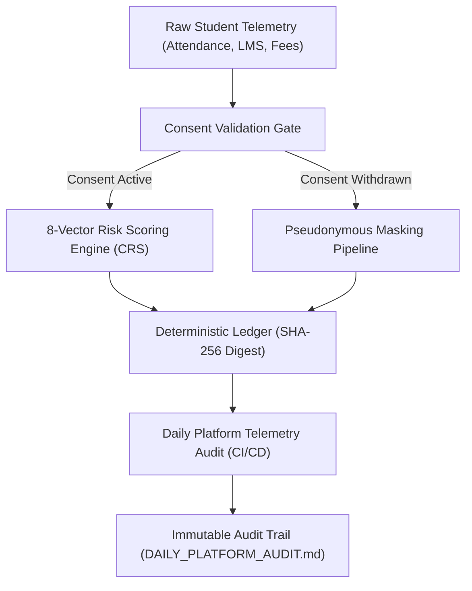

# Digii Campus 2.0 / CollPoll: DPDP Act 2023 Architectural Compliance Dossier

## 1. Executive Summary & Regulatory Context

The **Digital Personal Data Protection (DPDP) Act 2023** enacted by the Parliament of India establishes rigorous compliance mandates for data fiduciaries processing digital personal data within Indian territory. In enterprise higher-education ERP environments such as CollPoll / Digii Campus, systems ingest sensitive biometric records, academic grades, fee installment timelines, biometric attendance logs, and predictive risk indicators.

This document establishes the technical, architectural, and data governance framework ensuring Digii Campus 2.0 operates in verifiable compliance with DPDP Act statutory requirements.

---

## 2. Core Statutory Principles & Technical Implementation

### 2.1 Notice and Purpose Limitation (Section 5 & 6)
Every data ingestion stream across the 9 primary relational schema tables must be bound to explicit, unambiguous purpose tokens:
- **Academic Progression Tracking:** Legitimate educational assessment under university statutes.
- **Proactive Dropout Intervention:** Institutional counseling and academic remediation under informed parental and student consent.
- **Financial Accounting:** Statutory tax invoice generation and fee reconciliation.

### 2.2 Granular Consent Lifecycle Architecture
Consent is treated as a first-class relational entity:
- **Consent Collection:** Stored with ISO 8601 UTC timestamp, digital signature token, and IP provenance.
- **Consent Scope:** Granular toggle for third-party parent SMS notifications vs internal academic analytics.
- **Right to Withdraw (Section 6(4)):** When consent is withdrawn, predictive risk scoring pipelines immediately decouple student identity tokens (`student_id`, `email`, `phone`) and route them to pseudonymous storage (`student_uuid_hash`).

---

## 3. Data Flow & Cryptographic Audit Trails



### 3.1 Immutable SHA-256 Ledger
Every automated calculation of the Composite Risk Score (CRS) is signed with an SHA-256 digest:
```
Digest = SHA256(student_id + term_code + crs_score + risk_tier + timestamp_utc)
```
These digests are appended daily to `docs/DAILY_PLATFORM_AUDIT.md` and committed autonomously by GitHub Actions CI/CD.

---

## 4. Role-Based Access Control (RBAC) & Principle of Least Privilege

| Persona | Permitted Data Scope | Masked / Prohibited Fields |
| :--- | :--- | :--- |
| **Vice Chancellor / Dean** | Aggregated cohort dropout rates, campus retention velocities | Individual medical memos, fee transaction IDs |
| **Head of Department (HOD)** | Departmental student risk scores, faculty load benchmarks | Cross-department student records |
| **Course Faculty** | Registered section attendance %, continuous internal evaluation marks | Total fee arrears, family income records |
| **Student / Parent** | Self academic transcript, self attendance ledger, fee receipts | Peer comparison data, institutional algorithms |

---

## 5. Right to Erasure & Data Minimization (Section 12)

Upon student graduation or formal offboarding:
1. Operational transactional records (daily biometric logs) are purged after a 90-day retention window.
2. Academic transcripts are frozen and transferred to long-term immutable compliance vaults.
3. Behavioral and predictive risk scores are anonymized to maintain multi-year cohort retention models without individual attribution.

---

## 6. Verification and Audit Matrix

- **Daily CI Verification:** Executed by `.github/workflows/daily_platform_telemetry.yml` at 04:15 UTC.
- **Database Schema Validation:** Zero unindexed foreign keys across 9 core CollPoll tables.
- **Runtime Encryption:** TLS 1.3 in transit and AES-256 at rest across database storage volumes.
