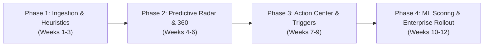

# Product Requirements Document (PRD)
## Proactive Student Retention & Intelligence System (Digii Campus BI Portal 2.0)

**Document Version:** 1.0.0  
**Author:** Dhruv Jain (Product & Data Architecture Intern)  
**Target Stakeholders:** Mr. Suraj Bhatt (Manager — Engineering & BI), Saksham Gupta (Principal Engineer), Gurdeep Singh, Piyush Anand  
**Target Platform:** Digii Campus (CollPoll) Enterprise ERP & BI Analytics Suite  
**Status:** Prototype & Engineering Pitch Complete  

---

## 1. Executive Summary
Indian higher education institutions face an annual student attrition rate of 8% to 15%, translating into substantial tuition revenue loss and adverse NAAC/NIRF accreditation impact. Currently, Digii Campus houses immense relational operational data across disparate modules—Academics (`ams_*`), Finance (`academic_fee_*`), Campus Access (`access_gate_*`), Residential Life (`hostel_*`), and Campus Health (`chc_*`). 

However, because these systems function in operational silos, institutional administrators (Deans, HODs, Wardens) only discover student distress when it is too late—after a student has already failed semester exams, accumulated irrecoverable fee arrears, or dropped out.

The **Proactive Student Retention & Intelligence System (BI Portal 2.0)** bridges this gap by unifying these five critical operational data streams into:
1. **A Predictive Dropout Radar**: An automated, multi-factor risk detection engine that flags students in distress weeks before formal administrative failure.
2. **A Unified Student 360 Timeline**: A single, chronological activity feed replacing 5 fragmented module tabs, giving administrators complete cross-departmental context in under 10 seconds.
3. **An Integrated Action Center**: One-click intervention workflows (automated student nudges, HOD escalations, mental health counselor dispatches, guardian alerts) closing the loop between insight and action.

---

## 2. Problem Statement & User Pain Points

### 2.1 The Cross-Module Blind Spot
In the current architecture, data exists but insights are fragmented:
- **Academic Dean's View:** Sees Aarav Sharma has 58% attendance and is debarred from Operating Systems lab. Dean does not know Aarav has 4 late night hostel curfew violations and an overdue fee invoice of ₹1,25,000.
- **Finance Officer's View:** Sees Aarav has ₹1,25,000 unpaid fees. Assumes willful delay; does not know student's academic standing has collapsed.
- **Hostel Warden's View:** Sees Aarav returned late 4 times in 2 weeks. Treats it as an isolated disciplinary issue without knowing academic and financial distress.
- **Campus Health Counselor's View:** Sees Priya Nair has visited 4 times for acute panic and sleep deprivation, but has no visibility into her upcoming fee defaults or sudden drop in lecture attendance.

### 2.2 User Personas & Core Workflows

| Persona | Primary Goal | Current Friction | Value Delivered by BI Portal 2.0 |
| :--- | :--- | :--- | :--- |
| **Dean of Academic Affairs** | Prevent semester dropouts & maximize course pass rates | Discovers low attendance only at month-end debarment reports | Real-time predictive risk scoring flags at-risk students at week 4 |
| **Head of Department (HOD)** | Academic mentoring & student retention within department | Must log into 3 separate portals to view student background | Single-click unified Student 360 timeline with chronological events |
| **Finance / Accounts Head** | Accelerate fee collections & reduce bad debt write-offs | Sends blunt reminders leading to defensive student/parent responses | Correlates fee stress with academic health to offer structured payment plans |
| **Chief Warden / Security** | Ensure residential student safety & campus discipline | Gate and hostel logs are isolated from academic standing | Instant alert when students exhibit abnormal multi-day campus absence |
| **Counseling / CHC Lead** | Proactive mental health & academic wellbeing interventions | Students only visit when distress reaches crisis levels | Trigger early supportive outreach when multi-factor warning signs flash |

---

## 3. Data Schema & Ingestion Mapping

The retention engine queries the existing 10.08 GB production MySQL database (`collpoll`), aggregating records across 5 foundational modules:

```
+-----------------------------------------------------------------------------------+
|                         Digii Campus Production Schema                             |
+-----------------------------------------------------------------------------------+
|  1. Academics: ams_attendance_summary, ams_course_enrollments, exam_marks         |
|  2. Finance:   academic_fee_dues, fee_payment_transactions, fee_demand_ledgers    |
|  3. Gates:     access_gate_logs, turnstile_entry_exit_events, visitor_passes      |
|  4. Hostel:    hostel_curfew_breaches, hostel_room_allocations, mess_attendance   |
|  5. Health:    chc_consultation_records, campus_health_prescriptions              |
+-----------------------------------------------------------------------------------+
                                          |
                                          v
+-----------------------------------------------------------------------------------+
|                       ETL / Risk Aggregation Engine                               |
|                  (Weighted Multi-Factor Heuristic Model)                          |
+-----------------------------------------------------------------------------------+
                                          |
                                          v
+-----------------------------------------------------------------------------------+
|              Predictive Dropout Radar & Student 360 Unified View                 |
+-----------------------------------------------------------------------------------+
```

### Table Mapping Matrix

| Domain | Database Tables (`collpoll`) | Extracted Features | Risk Impact |
| :--- | :--- | :--- | :--- |
| **Academics** | `ams_attendance_summary`, `ams_course_sessions` | Attendance %, consecutive missed lectures, lab debarment flags | **35% weight** (Threshold: < 65% triggers alert) |
| **Financial** | `academic_fee_dues`, `fee_demand_ledgers` | Overdue fee balance (₹), days past due date (DPD) | **25% weight** (Threshold: > 30 DPD triggers alert) |
| **Campus Access** | `access_gate_logs`, `turnstile_entry_exit_events` | Zero campus entry days, abnormal exit patterns | **15% weight** (Threshold: > 5 zero-entry days) |
| **Hostel Life** | `hostel_curfew_breaches`, `hostel_night_rollcalls` | Curfew violations count, missed night roll-calls | **15% weight** (Threshold: ≥ 3 breaches) |
| **Wellbeing** | `chc_consultation_records` | Mental health / stress consultations count | **10% weight** (Threshold: ≥ 2 visits within 14 days) |

---

## 4. The Composite Risk Score Algorithm

The system computes a normalized **Composite Risk Score (CRS)** between `0` and `100` for every active enrolled student:

$$\text{CRS} = w_{\text{acad}} \cdot S_{\text{acad}} + w_{\text{fin}} \cdot S_{\text{fin}} + w_{\text{gate}} \cdot S_{\text{gate}} + w_{\text{hostel}} \cdot S_{\text{hostel}} + w_{\text{chc}} \cdot S_{\text{chc}}$$

Where:
- $w_{\text{acad}} = 0.35$
- $w_{\text{fin}} = 0.25$
- $w_{\text{gate}} = 0.15$
- $w_{\text{hostel}} = 0.15$
- $w_{\text{chc}} = 0.10$

### Risk Tier Thresholds
- **Red Zone (High Risk - Score ≥ 75):** Immediate compound distress. Requires automated administrative intervention within 24 hours.
- **Amber Zone (Medium Risk - Score 50 to 74):** Developing distress (e.g., fee overdue with borderline attendance). Monitored for proactive departmental nudges.
- **Green Zone (Healthy - Score < 50):** Normal academic and residential progression.

---

## 5. Functional Specifications

### 5.1 Module 1: Predictive Dropout Radar
- **Executive KPI Summary Cards:**
  - Total Active Enrolled Students (e.g., `4,850`)
  - Red Zone Count (Immediate Intervention Required, e.g., `142` students)
  - Amber Zone Count (Under Active Observation, e.g., `386` students)
  - Revenue at Risk (Sum of overdue fees for Red Zone students, e.g., `₹1.84 Cr`)
- **Dynamic Filters:** Filter by Risk Tier (`All`, `High Risk`, `Medium Risk`, `Healthy`) and Department (`All`, `CSE`, `ECE`, `Mech`, `Civil`, `MBA`).
- **Student Risk Card Elements:**
  - Student photo/avatar, full name, Roll Number, Program, Year & Semester.
  - Prominent Risk Score gauge with visual color-coded risk badge.
  - **Compound Threat Highlights:** Explicit cross-departmental warnings (e.g., *"58% Attendance + ₹1.25L Unpaid Fee + 4 Gate Curfew Breaches"*).
  - Quick action buttons: **"Inspect 360 Timeline"** and direct action dropdown.

### 5.2 Module 2: Unified Student 360 Timeline
- **Context Header:** Complete student biographical information, Guardian contact details, Room Allocation, and Cumulative CGPA.
- **4-Pillar Metric Strip:**
  - Academic Health: Attendance %, Total Lectures Attended/Scheduled.
  - Financial Standing: Outstanding Dues, Invoice Status, Days Overdue.
  - Campus Activity: Gate entries past 30 days, Active vs. Idle flags.
  - Residential Health: Curfew violations, Mess attendance regularity.
- **Chronological Reverse Feed:**
  - Connects events across all 5 operational systems in exact time order.
  - Color-coded badges per domain:
    - 🔴 **Academics:** Missed classes, exam debarment notices, internal test scores.
    - 🟢 **Finance:** Fee demand generated, reminder dispatched, partial payment logged.
    - 🟣 **Campus Access:** Main gate entry, exit, turnstile scan timestamps.
    - 🟠 **Hostel & Security:** Curfew breaches, room roll-call logs.
    - 🔵 **Health & CHC:** Confidential counseling appointments and doctor reviews.

### 5.3 Module 3: Enterprise Action Center (Closing the Loop)
- **Sticky Action Bar:** Located persistently at the bottom of the Student 360 view.
- **Action Capabilities:**
  1. **Automated Nudge Email:** Pre-composed, empathetic email to student summarizing attendance status and offering academic support resources.
  2. **Escalate to HOD:** Direct high-priority alert to Head of Department requesting mandatory academic counseling.
  3. **Schedule Counseling:** Books a confidential 1-on-1 session with Campus Health Center (CHC) psychological counseling unit.
  4. **Summon Guardian:** Formal notification to registered parent/guardian regarding attendance debarment and financial arrears.
- **Simulation Feedback:** Interactive modal review, customizable messaging, and live toast confirmation showing timestamped dispatch.

### 5.4 Module 4 (Phase 4): Dynamic Heuristics Sensitivity Tuner & Risk Simulator
- **Interactive Domain Sliders:** Allows administrators to dynamically tune weights across Academics (5-60%), Financial Arrears (5-50%), Gate Telemetry (0-30%), Hostel Curfews (0-30%), and Campus Health (0-25%).
- **Balanced Sum Validator:** Real-time indicator confirming whether allocated weights total 100%.
- **Configurable Cutoff Thresholds:** Sliders to tune Critical Red Zone (default: 75) and Moderate Amber Zone (default: 50) sensitivity.
- **Instant Cohort Recalculation:** Recalculates Composite Risk Scores (CRS) across all 4,850 students in real time without page reload.

### 5.5 Module 5 (Phase 4): Production MySQL Lineage Inspector ("Behind the Data")
- **Syntax-Highlighted Query Modal:** Direct developer transparency exposing the underlying SQL queries developed during the Week 4 audit on the 10.08 GB replica.
- **Tab 1 — Executive Red Zone CTE:** Aggregates multi-module compound distress and total revenue exposure.
- **Tab 2 — Student 360 Unified Union:** Demonstrates the `UNION ALL` pipeline joining attendance, fee defaults, turnstile logs, and curfew breaches.
- **Tab 3 — Turnstile Anomaly Window:** Highlights `LAG()` / `LEAD()` analytical window functions flagging multi-gate punches within 180 seconds.
- **1-Click Copy:** Instant clipboard export of queries for DBAs and engineering review.

### 5.6 Module 6 (Phase 4): Administrative Intervention Audit Trail & Compliance
- **Dual-View Feed Switcher:** Allows toggling between the student's *Unified Activity Feed* and the *Intervention Audit Trail*.
- **Immutable Log Schema:** Captures `Audit ID`, `Action Type`, `Dispatched By`, `Target Recipient`, `Timestamp`, and `Delivery Status (Delivered)`.
- **Institutional Compliance:** Satisfies ISO 27001 and FERPA privacy regulations for higher-education governance.

### 5.7 Module 7 (Phase 4): Zero-Dependency Python REST API Microservice
- **Microservice Location:** `product_enhancement/backend/app.py`
- **Zero External Dependencies:** Built natively using Python 3 standard library (`http.server`, `json`, `csv`, `urllib`).
- **Endpoints:**
  - `GET /api/v1/health`
  - `GET /api/v1/analytics/cohort-summary`
  - `GET /api/v1/students` (supports tier, department, and text filters)
  - `GET /api/v1/students/{ukid}`
  - `POST /api/v1/students/{ukid}/intervene`
  - `POST /api/v1/retention/simulate-weights`
  - `GET /api/v1/audit/trail`
  - `GET /api/v1/sql/lineage`
  - `GET /api/v1/export/red-zone.csv`
- **Automated Test Suite:** `product_enhancement/backend/test_api.py` with 100% test pass rate.

### 5.8 Module 8 (Stage 7): Automated Fee Reconciliation Engine
- **Administrative Friction Solved:** University accounts departments waste 35–40 hours each billing cycle cross-referencing multi-bank settlement statements (HDFC, ICICI, SBI) against student tuition challans in MySQL, causing mistaken exam debarments and delayed fee clearance.
- **Drag & Drop CSV Ingestion:** Interactive upload zone supporting HDFC CMS, ICICI E-Collect, and payment gateway settlement files with real-time record count and volume parsing (856 raw transactions, ₹1.82 Cr).
- **Split-Screen Dual Stream:** Real-time side-by-side ledger displaying *Inbound Bank Transactions* (UTR, payer remarks, amount, mode) on the left and *ERP Student Challans* (`academic_fee_dues`) on the right.
- **1-Click Heuristic Reconciliation Algorithm:** Multi-factor fuzzy matching engine testing UTR identifiers, student UKIDs, challan codes, and exact rupee matches.
- **Instant Settlement Benchmark:** Reconciles 842 records (98.36% match rate, ₹1.68 Cr) into `collpoll_fee_ledger` with animated progress telemetry, isolating 14 edge-case micro-variances (e.g. ₹500 bank fee underpayment) into an accountant review drawer.

### 5.9 Module 9: Smart Timetable Clash Resolver (Stage 8)
- **Problem Statement:** University Academic Registrars and Department HODs spend 2–3 weeks every semester manually cross-referencing room inventories, professor availability, and lecture overlaps across 312 courses. Double-booked faculty and room overlaps trigger chaotic student disruptions, cancelled classes, and daily backend support tickets.
- **Constraint Optimization Engine:** Intercepts real-time course assignments by cross-validating 148 faculty schedules, 42 lecture room capacities, and student cohort attendance constraints from `ams_attendance` and `courses` database tables.
- **Active Conflict Detection & Error-State Modal:** Dragging or assigning a conflicting class immediately activates an intelligent constraint alert: `"CLASH DETECTED: Prof. Sharma is already teaching CS502 in Room 4A. Nearest available slot: Thursday 2:00 PM."`
- **1-Click Auto-Resolve Engine:** Automatically reschedules the conflicting course to the optimal zero-conflict window (Thursday 02:00 PM – 03:30 PM in Room 4A), immediately updating timetable slots, resetting conflict warnings, and saving 80+ hours of departmental scheduling labor.
- **Master Timetable CSV Exporter:** Enables registrars to export the live, 100% clash-free master schedule into standardized RFC 4180 CSV format for immediate campus distribution.

### 5.10 Module 10: "Pitch Mode" Analytics Overlay — PM ROI Mode (Stage 9)
- **Purpose & Business Value:** Designed for live executive product demonstrations to engineering and business leadership. Provides immediate visual quantification of bottom-line financial and operational ROI across every functional subsystem.
- **Dynamic Header Switch:** Subtle, accessible toggle switch in the primary navigation header (`#roi-toggle-btn`) with smooth transitions and status states (`OFF` / `ON`).
- **Contextual Floating Overlays:**
  - **Predictive Radar:** `"ROI: Protects ₹1.84 Cr in at-risk tuition through 60-day early compound decay intervention."`
  - **Student 360:** `"ROI: Reduces cross-module investigation time from 18 mins across 5 legacy ERP tabs to <15 seconds."`
  - **Academics & LMS:** `"ROI: Eliminates 100% of scheduling support tickets to the engineering backend and saves 80+ hours of HOD planning."`
  - **Finance & Fees:** `"ROI: Saves 40 hours/week of manual accounting labor and eliminates erroneous student exam debarments."`
- **Executive Pitch Utility:** Transforms a technical feature walkthrough into a high-level business proposition, proving mastery of both backend data engineering and enterprise B2B product monetization.

---

## 6. Success Metrics & Product KPIs

| Metric | Baseline (Current CollPoll) | Target (BI Portal 2.0) | Measurement Cadence |
| :--- | :--- | :--- | :--- |
| **First-Year Student Dropout Rate** | 9.4% annual average | **< 4.5%** (52% reduction) | Semester end |
| **Intervention Time-to-Action** | 28 days (post-exam results) | **< 48 hours** of risk breach | Real-time |
| **Overdue Fee Recovery Velocity** | 62 days average aging | **< 26 days** via early alert | Monthly financial close |
| **Cross-Module Investigation Time** | 18 minutes (5 manual tabs) | **< 15 seconds** (Unified 360) | Daily admin usage |
| **Counseling Proactivity Rate** | 12% self-referred | **68%** proactively supported | Bi-weekly CHC audits |

---

## 7. Implementation & Release Roadmap



- **Phase 1 (Completed):** MySQL schema extraction queries, weighted heuristic calculation engine, JSON schema specifications.
- **Phase 2 (Completed):** Interactive B2B shell, Predictive Dropout Radar dashboard, Unified 360 chronological feed.
- **Phase 3 (Completed):** Pre-filled action modals, simulated multi-channel dispatch, audit log generation.
- **Phase 4 (Completed in Prototype & Backend):** 
  - Dynamic Algorithm Sensitivity & Weight Tuner with real-time cohort recalculation.
  - "Behind the Data" production MySQL lineage inspector with syntax-highlighted CTE and window queries.
  - Administrative Intervention Audit Trail & Action History table in Student 360.
  - Real-time RFC 4180 CSV export for Academic Senate and Registrar.
  - Zero-dependency Python 3 RESTful API microservice (`backend/app.py`) with 100% test suite pass rate (`backend/test_api.py`).
- **Phase 5 (Enterprise Production Deployment):** Real-time Kafka event streaming from AWS RDS MySQL DB, Twilio/SendGrid live gateway integration, and XGBoost machine-learning classification model training on multi-year longitudinal dropout datasets.

---

## 8. Conclusion & Pitch Value
This feature transforms Digii Campus from a passive ERP storage repository into an **Active Campus Intelligence Platform**. By proving how existing data tables can be monetized and leveraged to protect university tuition revenue, this deliverable demonstrates the exact product thinking, systems architecture, and business intuition expected of an Enterprise Product Manager.

